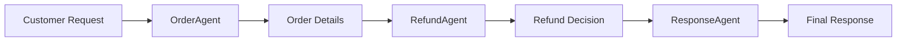
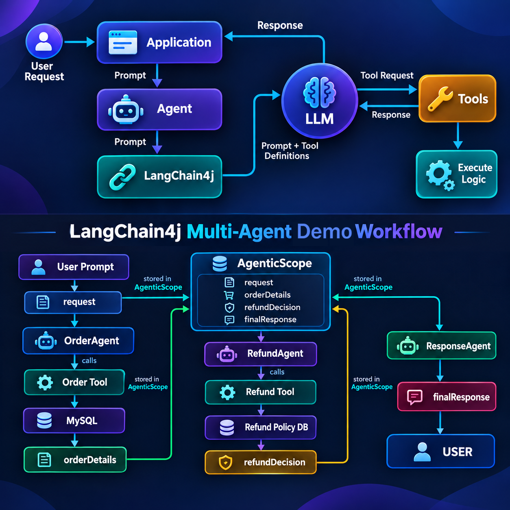
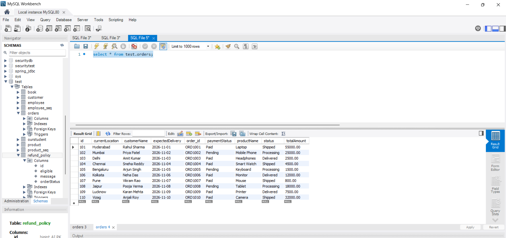
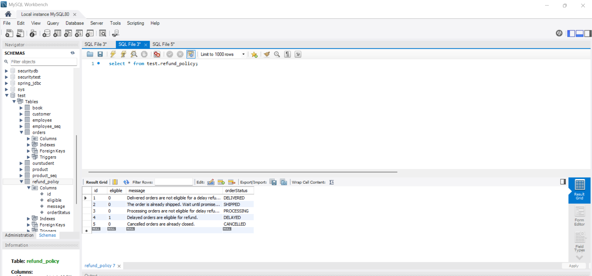
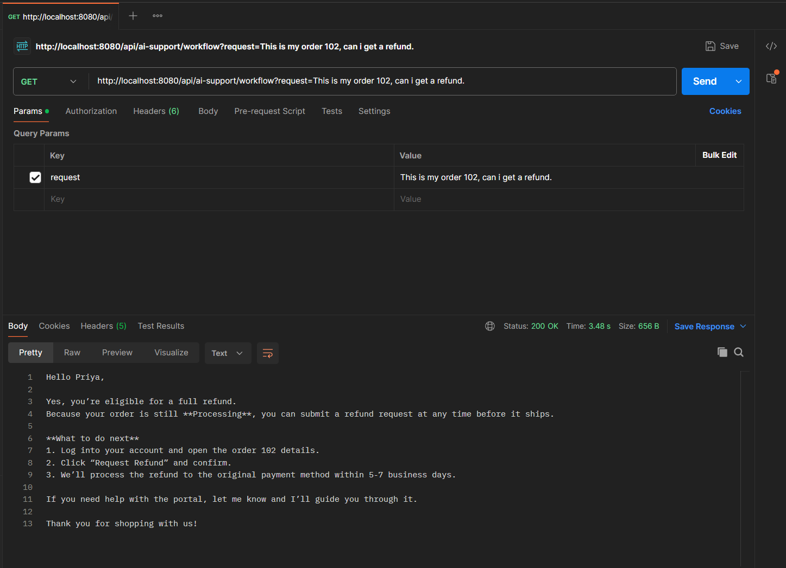
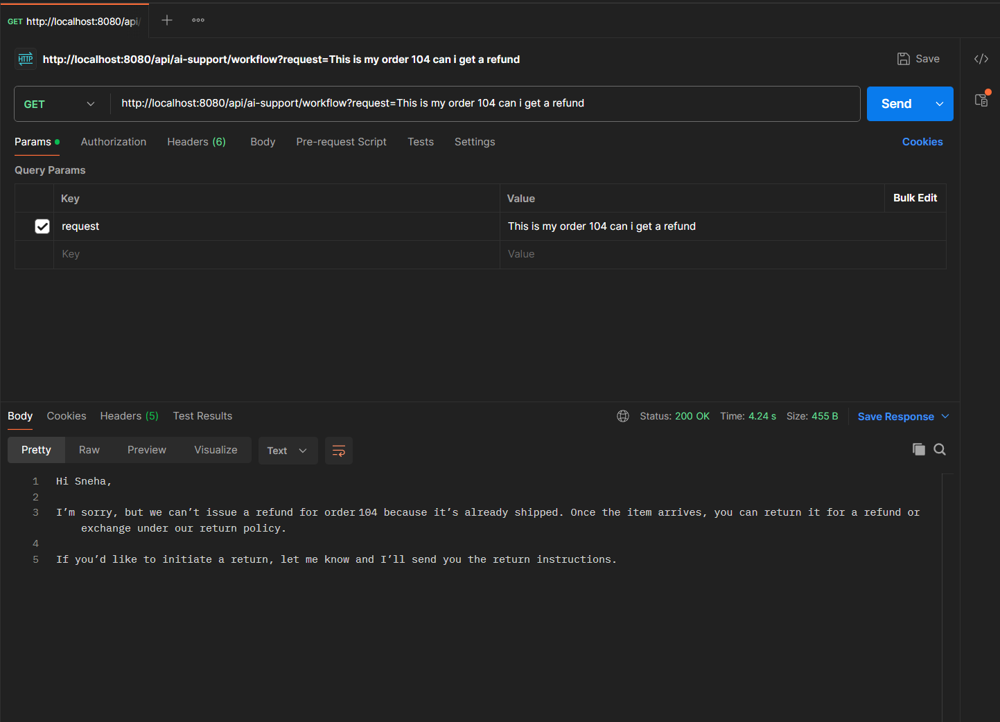

# LangChain4j Multi-Agent Demo

A Spring Boot application demonstrating LangChain4j's multi-agent capabilities for building intelligent customer support systems. This project showcases how to use sequential AI agents to handle complex customer queries, specifically for order tracking and refund eligibility checks.

## 📋 Table of Contents

- [Overview](#overview)
- [Features](#features)
- [Architecture](#architecture)
- [Tech Stack](#tech-stack)
- [Prerequisites](#prerequisites)
- [Installation](#installation)
- [Configuration](#configuration)
- [Database Setup](#database-setup)
- [Running the Application](#running-the-application)
- [API Endpoints](#api-endpoints)
- [Workflow Explanation](#workflow-explanation)
- [Project Structure](#project-structure)
- [Usage Examples](#usage-examples)
- [Troubleshooting](#troubleshooting)

## Overview

This project demonstrates a multi-agent AI system that:
- Processes customer support requests using LangChain4j's agentic framework
- Coordinates multiple specialized agents (Order, Refund, Response) to handle complex queries
- Integrates with real database data through custom tools
- Provides REST API endpoints for different interaction modes

## Features

- **Multi-Agent Workflow**: Sequential execution of specialized agents for complex tasks
- **Tool Integration**: Custom tools for database interactions (order lookup, refund policy checks)
- **Three Interaction Modes**:
  - Simple chat with basic AI
  - Order support with tool-enabled AI
  - Full multi-agent workflow for refund requests
- **Debug Logging**: Built-in agent listener for tracking execution flow
- **Database Integration**: MySQL-based order and refund policy storage
- **OpenAI-Compatible API**: Uses Groq API for AI model integration

## Architecture

The multi-agent workflow for refund requests:





### Agent Responsibilities

1. **OrderAgent**: Extracts order ID from customer request and fetches order details from database
2. **RefundAgent**: Analyzes order status and checks refund eligibility using policy data
3. **ResponseAgent**: Generates a clear, helpful customer response based on all gathered information

## Tech Stack

- **Java**: 21
- **Spring Boot**: 4.1.1
- **LangChain4j**: 1.21.0-beta31
  - OpenAI Spring Boot Starter
  - Agentic framework
- **Database**: MySQL with Spring Data JPA
- **Build Tool**: Maven
- **AI Model**: Groq API (OpenAI-compatible, model: openai/gpt-oss-20b)

## Prerequisites

- Java 21 or higher
- Maven 3.6+
- MySQL 8.0+
- Groq API Key ([Get one here](https://groq.com/))

## Installation

1. Clone the repository:
```bash
git clone <repository-url>
cd langchain4j-multi-agent-demo
```

2. Install dependencies:
```bash
mvn clean install
```

## Configuration

1. Create a `.env` file in the project root (copy from `.env.example`):
```bash
cp .env.example .env
```

2. Edit `.env` with your credentials:
```env
GROQ_API_KEY="your-groq-api-key"
MODEL_NAME="openai/gpt-oss-20b"
DB_USERNAME="your-mysql-username"
DB_PASSWORD="your-mysql-password"
```

3. Configure database connection in `src/main/resources/application.yaml`:
```yaml
spring:
  datasource:
    url: jdbc:mysql://localhost:3306/test
    username: ${DB_USERNAME}
    password: ${DB_PASSWORD}
```

## Database Setup

1. Create a MySQL database:
```sql
CREATE DATABASE test;
```

2. The application will automatically create the required tables (`orders` and `refund_policy`) on startup due to `ddl-auto: update` configuration.

3. Sample data for `orders` table:
```sql
INSERT INTO orders (customer_name, product_name, status, current_location, expected_delivery, total_amount, payment_status)
VALUES 
('Priya Patel', 'Mobile Phone', 'Processing', 'Mumbai', '2026-11-02', 25000.00, 'Pending'),
('John Doe', 'Laptop', 'Shipped', 'Delhi', '2026-11-05', 55000.00, 'Paid');
```


4. Sample data for `refund_policy` table:
```sql
INSERT INTO refund_policy (order_status, eligible, message)
VALUES 
('Processing', true, 'Orders in Processing stage are eligible for full refund before shipping'),
('Shipped', false, 'Orders that have been shipped are not eligible for refund'),
('Delivered', false, 'Delivered orders are not eligible for refund');
```


## Running the Application

Using Maven:
```bash
mvn spring-boot:run
```

The application will start on `http://localhost:8080`

## API Endpoints

### 1. Simple Chat
Basic AI chat without tools or workflow.

**Endpoint**: `GET /api/ai-support?message={message}`

**Example**:
```bash
curl "http://localhost:8080/api/ai-support?message=Hello"
```

### 2. Order Support
AI agent with tool integration for order-related queries.

**Endpoint**: `GET /api/ai-support/order?message={message}`

**Example**:
```bash
curl "http://localhost:8080/api/ai-support/order?message=What is the status of order 102?"
```

### 3. Multi-Agent Workflow
Sequential agent execution for complex refund requests.

**Endpoint**: `GET /api/ai-support/workflow?request={request}`

**Example**:
```bash
curl "http://localhost:8080/api/ai-support/workflow?request=This is my order 102, can I get a refund?"
```


## Workflow Explanation

The multi-agent workflow for refund requests follows this sequence:

1. **OrderAgent** (`checkOrder`):
   - Extracts order ID from customer request
   - Calls `getOrderStatus` tool to fetch order details from database
   - Outputs order details to shared scope

2. **RefundAgent** (`checkRefund`):
   - Receives order details from previous agent
   - Determines order status
   - Calls `checkRefundEligibility` tool to check policy
   - Outputs refund decision to shared scope

3. **ResponseAgent** (`createResponse`):
   - Receives original request, order details, and refund decision
   - Generates a helpful customer response
   - Outputs final response

The `DebugAgentListener` logs each step for observability.

## Project Structure

```
langchain4j-multi-agent-demo/
├── src/main/java/org/aadi/
│   ├── agents/                  # Agent interfaces
│   │   ├── OrderAgent.java      # Order lookup agent
│   │   ├── RefundAgent.java     # Refund eligibility agent
│   │   ├── ResponseAgent.java   # Response generation agent
│   │   └── WorkflowSupportAgent.java  # Workflow orchestrator
│   ├── config/
│   │   └── AgentConfig.java     # Agent bean configuration
│   ├── controller/
│   │   └── AiSupportController.java  # REST API endpoints
│   ├── listener/
│   │   └── DebugAgentListener.java   # Agent execution logging
│   ├── model/
│   │   ├── OrderEntity.java    # Order entity
│   │   └── RefundPolicy.java   # Refund policy entity
│   ├── repository/
│   │   ├── OrderRepository.java
│   │   └── RefundPolicyRepository.java
│   ├── service/
│   │   ├── MyAIAgent.java       # Simple AI service
│   │   ├── OrderService.java    # Order business logic
│   │   ├── OrderSupportAIAgent.java  # Order support with tools
│   │   └── RefundService.java   # Refund business logic
│   └── tool/
│       ├── OrderTools.java      # Order-related tools
│       └── RefundTool.java      # Refund-related tools
├── src/main/resources/
│   └── application.yaml         # Application configuration
├── screenshots/
│   └── diagram.png             # Workflow diagram
├── .env.example                # Environment variables template
├── .gitignore
└── pom.xml                     # Maven configuration
```

## Usage Examples

### Example 1: Order Status Query
```bash
curl "http://localhost:8080/api/ai-support/order?message=What is the status of order 102?"
```

**Response**: The AI will use the `getOrderStatus` tool to fetch real order data and provide status information.

### Example 2: Refund Request (Multi-Agent Workflow)
```bash
curl "http://localhost:8080/api/ai-support/workflow?request=This is my order 102, can I get a refund?"
```

**Workflow**:
1. OrderAgent fetches order details (Order 102, Processing status)
2. RefundAgent checks eligibility (Processing = eligible)
3. ResponseAgent generates helpful response with refund instructions

**Sample Response**:
```
Hello Priya,

Yes, you're eligible for a full refund.  
Because your order is still **Processing**, you can submit a refund request at any time before it ships.

**What to do next**  
1. Log into your account and open the order 102 details.  
2. Click "Request Refund" and confirm.  
3. We'll process the refund to the original payment method within 5-7 business days.

If you need help with the portal, let me know and I'll guide you through it.

Thank you for shopping with us!
```

### Example 3: Invalid Order
```bash
curl "http://localhost:8080/api/ai-support/workflow?request=This is my order 104, can I get a refund?"
```

**Response**: The system will detect that order 104 doesn't exist and ask the customer to verify the order number.


## Troubleshooting

### Database Connection Issues
- Ensure MySQL is running on localhost:3306
- Verify database credentials in `.env` file
- Check that the database `test` exists

### API Key Issues
- Verify your Groq API key is valid
- Ensure the `.env` file is in the project root
- Check that the key has proper permissions

### Agent Execution Issues
- Enable request/response logging in `application.yaml` by uncommenting:
  ```yaml
  log-requests: true
  log-responses: true
  ```
- Check console output for `DebugAgentListener` logs
- Verify tools are being called correctly

## License

This project is for demonstration purposes.

## Contributing

Contributions are welcome! Please feel free to submit a Pull Request.